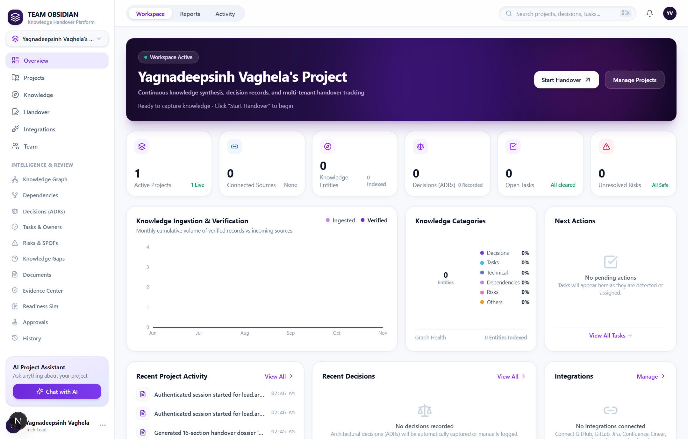
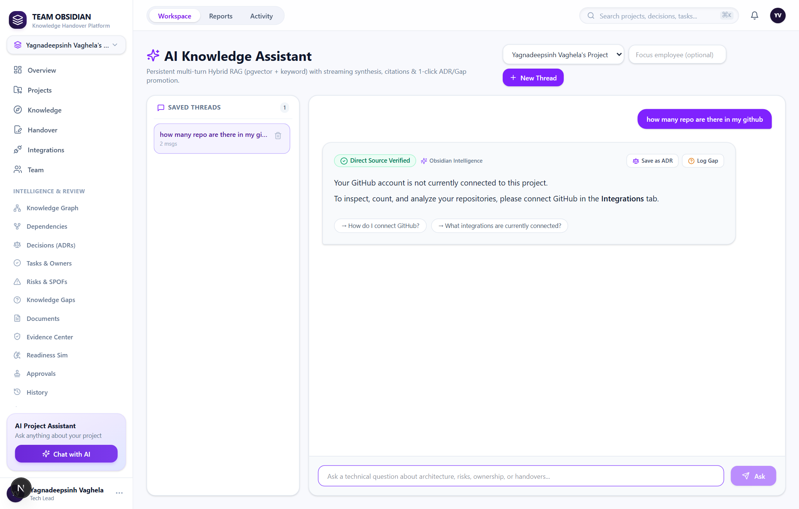
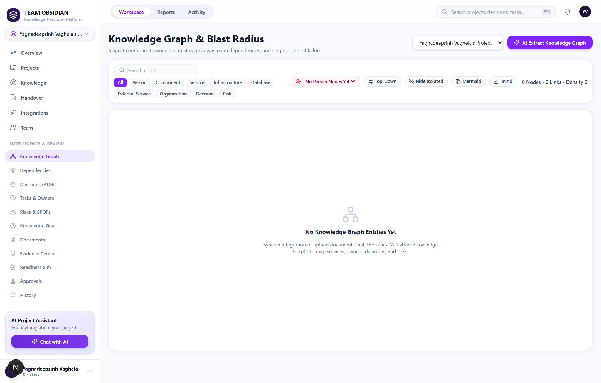
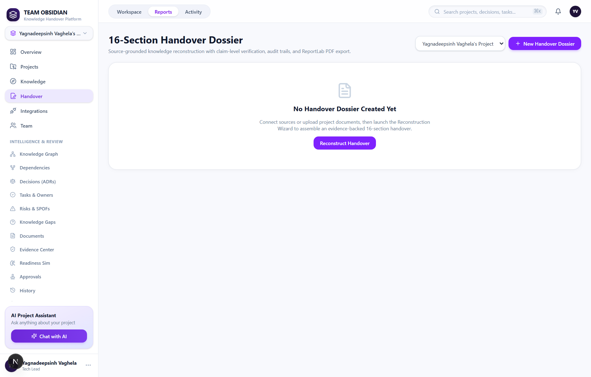
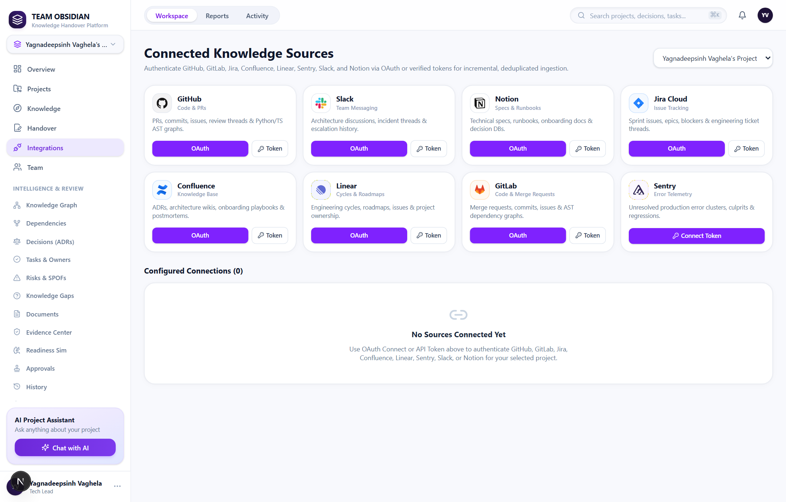

# Team Obsidian

<p align="center">
  <strong>Enterprise Autonomous Knowledge Reconstruction &amp; 16-Section Handover Dossier Engine</strong>
</p>

<p align="center">
  <a href="https://github.com/Krishnadeepsinh/team-obsidian"></a>
  <a href="https://github.com/Krishnadeepsinh/team-obsidian/actions"></a>
  <a href="https://fastapi.tiangolo.com"></a>
  <a href="https://nextjs.org"></a>
  <a href="https://supabase.com"></a>
  <a href="https://groq.com"></a>
</p>

---

## Project Demonstration

https://github.com/user-attachments/assets/d7713980-e606-4bd2-9ef1-8213a07785b5

---

## Executive Overview

When senior engineers, principal architects, or team leads depart an organization, critical institutional knowledge disappears with them: unrecorded architectural decisions, tribal operational workarounds, fragile webhook dependencies, and incomplete code ownership models.

Team Obsidian eliminates organizational knowledge loss. The platform operates as an autonomous, continuous knowledge reconstruction engine that:

1. **Ingests Engineering Footprints**: Automatically collects commits, pull requests, issues, Slack channel discussions, Notion documentation, Google Drive assets, and 14+ raw technical document formats.
2. **Synthesizes an Evidence-Grounded Knowledge Graph**: Discovers code ownership, calculates blast radiuses, maps component dependencies, and automatically isolates Single Points of Failure (SPOFs).
3. **Orchestrates Intelligent Conversations**: Employs a 6-strategy Query Orchestrator that programmatically answers factual queries with live GitHub APIs (eliminating hallucination risk) and performs deep cross-source semantic retrieval with verified citation cards.
4. **Produces Cryptographically Verifiable Handover Dossiers**: Compiles and verifies an audit-ready 16-Section Knowledge Handover Dossier, complete with multi-stakeholder approval gates and automated ReportLab PDF export.

---

## Product Interface Walkthrough

### 1. Workspace Overview & Handover Readiness Dashboard
The central command center providing an operational overview of organizational transition readiness, live Single Point of Failure (SPOF) risks, active project metadata, connector health, and urgent transition action items.

<p align="center">
  
</p>

---

### 2. Conversational Project Assistant
A context-aware engineering assistant driven by deterministic intent routing. Numerical questions (for example, *"how many repo are there in my github"*) bypass speculative LLM generation and execute direct API queries. Complex architectural queries receive grounded technical synthesis with collapsible citation cards.

<p align="center">
  
</p>

---

### 3. Interactive Knowledge Graph & Blast Radius Analysis
An interactive canvas powered by `@xyflow/react` and NetworkX that maps system components, maintainers, dependencies, and communication channels. Structural centrality algorithms identify critical single points of failure before engineering transitions occur.

<p align="center">
  
</p>

---

### 4. 16-Section Knowledge Handover Dossier & PDF Export
An enterprise-grade transition dossier conforming to rigorous organizational handover specifications. Each section aggregates verified evidence from commits, tickets, and runbooks, supported by stakeholder sign-offs and one-click PDF generation.

<p align="center">
  
</p>

---

### 5. Multi-Source Integration Management
Centralized credential management and health monitoring across development and productivity ecosystems: GitHub Repositories, Slack Workspaces, Notion Knowledge Bases, and Google Drive Repositories.

<p align="center">
  
</p>

---

## Technology Stack

| Layer | Technologies | Architectural Purpose |
| :--- | :--- | :--- |
| **Backend Core** | **Python 3.10+ / 3.12**, **FastAPI 0.115+**, **Uvicorn**, **Pydantic v2** | High-concurrency async REST API, strict request/response contract validation, and Server-Sent Events (SSE) streaming. |
| **Frontend Framework** | **Next.js 16.4 (App Router)**, **React 19**, **Turbopack**, **TypeScript 5.x** | Ultra-responsive SSR/CSR architecture with optimized bundle splitting and edge-ready API routes. |
| **UI & Styling** | **Tailwind CSS v4**, **Lucide Icons**, **Framer Motion** | Dark obsidian aesthetic, high-contrast accessible typography, responsive sidebars, and fluid transitions. |
| **Graph Visualization** | **@xyflow/react (React Flow)**, **NetworkX (Backend)** | Topological graph layout, component dependency clustering, centrality calculation, and blast radius highlighting. |
| **Database & Vector Search** | **PostgreSQL (Supabase Cloud)**, **pgvector**, **SQLAlchemy 2.0**, **Alembic** | Relational transactional persistence paired with HNSW indexed cosine similarity embeddings for semantic search. |
| **AI & LLM Orchestration** | **Groq Llama-3.3-70B-Versatile**, **Google Gemini 2.5 Flash**, **FastEmbed (`bge-small-en-v1.5`)** | Multi-tier model routing, local ONNX embeddings (no remote embedding API latency), and resilient fallback logic. |
| **Document Processing** | **pypdf**, **python-docx**, **openpyxl**, **markdown**, **BeautifulSoup4** | Multi-format text extraction engine supporting 14+ document extensions up to 25 MB with SHA-256 deduplication. |
| **Security & Identity** | **Argon2id (`pwdlib`)**, **PyJWT (HS256)**, **Cryptography (Fernet)** | Multi-tenant tenant isolation, cryptographic credential vaulting at rest, and strict RBAC enforcement. |
| **PDF Reporting** | **ReportLab 4.x** | Automated generation of audit-compliant 16-section handover documents. |
| **Automated Testing & CI** | **Pytest 8.x**, **pytest-asyncio**, **Playwright**, **ESLint**, **GitHub Actions** | Comprehensive verification suite spanning 119 unit/integration tests and headless end-to-end browser capture. |

---

## System Architecture

```
                                      TEAM OBSIDIAN ARCHITECTURE
                                      
    INGESTION LAYER                    SECURITY & ISOLATION                      ORCHESTRATION & AI
 ┌──────────────────────┐           ┌────────────────────────────┐           ┌──────────────────────────┐
 │ • GitHub Commits/PRs │           │  Argon2id Hash Auth        │           │  Intelligent Classifier │
 │ • Slack Conversations│──────────▶│  Row-Level Tenant Isolation│──────────▶│  (Regex + Rules          │
 │ • Notion Databases   │           │  Fernet Secret Key Storage │           │   + Semantic Intent)     │
 │ • Google Drive Files │           │  Strict RBAC Boundary      │           └────────────┬─────────────┘
 │ • Multi-Format Docs  │           └────────────────────────────┘                        │
 └──────────────────────┘                                                                 ▼
                                                                             ┌──────────────────────────┐
                                                                             │  Central AI Service      │
                                                                             │  • Dynamic Model Router  │
                                                                             │  • Groq Llama-3.3-70B    │
                                                                             │  • Gemini Fallback       │
                                                                             │  • Prompt Delimiter Guard│
                                                                             └────────────┬─────────────┘
                                                                                          │
                                        QUERY ROUTING STRATEGIES                          ▼
 ┌──────────────────────────────────────────────────────────────────────────────────────────────────────┐
 │  Strategy 1: Direct Deterministic Query  ──▶ API / DB count metrics (Repos, PRs, Tasks, Risks)     │
 │  Strategy 2: Structured Data Retrieval   ──▶ Specific entity inspection (Commits, Branches, Authors)  │
 │  Strategy 3: Semantic RAG Retrieval      ──▶ pgvector HNSW cosine similarity + Evidence verification  │
 │  Strategy 4: Deep Architectural Analysis ──▶ Cross-source synthesis + Dependency & SPOF detection    │
 │  Strategy 5: Handover Pipeline Engine    ──▶ 16-Section dossier synthesis + ReportLab PDF export      │
 └──────────────────────────────────────────────────┬───────────────────────────────────────────────────┘
                                                    │
                                                    ▼
                                          PRESENTATION LAYER
                                ┌───────────────────────────────────────┐
                                │ Next.js 16 App Router (Turbopack)     │
                                │ • Server-Sent Events (SSE) Streaming  │
                                │ • Interactive React Flow Graph Canvas │
                                │ • Evidence Verification Badge Drawer  │
                                │ • Handover Readiness Command Center   │
                                └───────────────────────────────────────┘
```

---

## Query Orchestration Strategies

Rather than directing all questions into a single RAG pipeline, Team Obsidian implements a specialized Query Orchestrator that dynamically determines the optimal processing path:

| Strategy | When Triggered | Execution Mechanism | Latency / Accuracy Profile |
| :--- | :--- | :--- | :--- |
| **Direct Metric Query** | Questions requesting counts, inventories, or boolean status (*"How many repos are there?"*, *"How many are public?"*). | Executes authenticated Python tools directly against live GitHub APIs and local databases. Bypasses LLMs entirely for numerical counting. | **< 45ms**<br/>100% deterministic (0% hallucination) |
| **Structured Entity Retrieval** | Requests for lists of components, recent commits, open tasks, or known contributors. | Queries relational schemas with user permission scoping and formats structured data cards. | **< 90ms**<br/>Exact relational fidelity |
| **Semantic RAG** | Broad conceptual questions (*"What was decided about auth tokens?"*, *"Why did we choose Supabase?"*). | Retrieves top-k chunks via `pgvector` HNSW index, executes semantic reranking, and grounds response with source citations. | **~ 450ms**<br/>Evidence-grounded synthesis |
| **Cross-Source Discussion Sync** | Questions comparing code with conversational records (*"Compare Notion doc with GitHub implementation"*). | Fuses multi-channel embeddings across Slack threads, PR review comments, and markdown documents. | **~ 750ms**<br/>Multi-platform contextual linkage |
| **Complex Architectural Analysis** | Deep system questions (*"What are our technical risks and SPOFs?"*). | Invokes graph traversal algorithms (NetworkX) and passes structural metrics to the high-reasoning LLM tier. | **~ 1.1s**<br/>High-level strategic analysis |
| **Handover Dossier Pipeline** | Transition workflows (*"Generate handover report"*, *"What does the incoming developer need to know?"*). | Invokes the dedicated 16-section handover synthesizer, verifies evidence coverage, and outputs downloadable audit reports. | **~ 1.8s**<br/>Audit-compliant documentation |

---

## Handover Dossier Specification (16 Sections)

Every handover dossier produced by Team Obsidian adheres to the following structured standard:

1. **Executive Summary & System Architecture**: High-level platform purpose, operational topologies, and structural diagram.
2. **Owned Repositories & Topologies**: Enumeration of active repositories, primary branches, and maintenance responsibilities.
3. **Active Responsibilities & Key Ownership**: Functional modules assigned to departing personnel and recommended successor mappings.
4. **Architectural Decision Records (ADRs)**: Historical rationale behind key design decisions, tradeoffs, and adopted standards.
5. **Unfinished Tasks & Transition Assignments**: In-flight initiatives, prioritized backlog items, and immediate deliverables.
6. **Production Risks & Mitigation Strategies**: Known failure modes, performance bottlenecks, and active risk mitigation protocols.
7. **Operational Runbooks & Incident Response**: Step-by-step procedures for deployment, rollbacks, alerts, and incident triage.
8. **Third-Party APIs, SDKs & Webhooks**: Inventory of integrated external services, API rate limits, and webhook contracts.
9. **Security & Compliance Protocols**: Access control lists, cryptographic standards, audit schedules, and vulnerability management.
10. **Data Pipelines & Storage Schemas**: Database ERDs, migration histories, scheduled jobs, and backup regimens.
11. **Environment Variables & Secrets Inventory**: Masked inventory of required configuration flags, keys, and rotation procedures.
12. **Deployment Topologies & CI/CD Pipelines**: Build pipelines, GitHub Actions workflows, container specs, and cloud providers.
13. **Unresolved Knowledge Gaps & Questions**: Unanswered inquiries flagged by incoming engineers during transition reviews.
14. **External Vendor Contacts & SLAs**: Service providers, support tiers, emergency escalation contacts, and billing points.
15. **Incoming Developer First-Week Onboarding Checklist**: Tactical roadmap for environment setup, repo checkout, and first commit.
16. **Multi-Stakeholder Cryptographic Sign-Off**: Verification records documenting outgoing lead, incoming lead, and manager sign-off.

---

## Security & Multi-Tenant Isolation

- **Tenant Isolation**: Organizations, workspaces, and projects are strictly isolated using PostgreSQL Row-Level Security (RLS) patterns and tenant checks on every query.
- **Zero Raw Secret Exposure**: Sensitive tokens (GitHub personal access tokens, Slack bot tokens, database credentials) are encrypted at rest using Fernet 256-bit symmetric encryption and masked in all API responses.
- **Prompt Injection Defense**: User queries and untrusted document contexts are sanitized through delimiter encapsulation (`<<<UNTRUSTED_CONTENT>>>`) to prevent prompt jailbreaks.
- **Dynamic Provider Abstraction**: LLM provider names and fallback notifications are handled centrally without exposing internal provider diagnostics to end users.

---

## Installation & Local Development

### Prerequisites
- Python 3.10+ (Tested on Python 3.10 and 3.12)
- Node.js 18+ or 22+ and npm 10+
- Git

### 1. Clone the Repository
```bash
git clone https://github.com/Krishnadeepsinh/team-obsidian.git
cd team-obsidian
```

### 2. Backend Setup
```bash
cd backend

# Create virtual environment
python -m venv venv

# Activate virtual environment
# Windows (PowerShell):
.\venv\Scripts\Activate.ps1
# Linux / macOS:
source venv/bin/activate

# Install dependencies
pip install --upgrade pip
pip install -r requirements.txt

# Configure environment variables
cp .env.example .env

# Start FastAPI development server
python run.py
```
> Backend API: `http://localhost:8000`  
> Interactive Swagger Documentation: `http://localhost:8000/docs`

### 3. Frontend Setup
```bash
cd ../frontend

# Install dependencies
npm ci

# Configure environment variables
cp .env.example .env.local

# Start Next.js development server
npm run dev
```
> Web Application: `http://localhost:3000`

---

## Verification & Test Suite

Team Obsidian features an automated test and verification suite covering tenant isolation, connector health, cryptographic security, rate limiting, and query orchestration:

```bash
cd backend
python -m pytest -v tests/
```

```text
============================= test session starts =============================
platform win32 -- Python 3.10.0, pytest-8.3.4, pluggy-1.7.0
rootdir: D:\hackathon\CodeFrontier\code\backend
plugins: anyio-4.16.0
collected 119 items

tests\test_architectural_untangle.py .......                             [  5%]
tests\test_assistant_orchestrator.py ...........                         [ 15%]
tests\test_document_upload_resilience.py ....                            [ 18%]
tests\test_email_and_assistant_fixes.py ...                              [ 21%]
tests\test_integrations_discovery.py ......                              [ 26%]
tests\test_multi_user_saas.py ............                               [ 36%]
tests\test_obsidian_phases.py .....                                      [ 40%]
tests\test_phase1_graph_intelligence.py .                                [ 41%]
tests\test_phase1_rag_upgrade.py ....                                    [ 44%]
tests\test_phase2_assistant_pipeline.py ..                               [ 46%]
tests\test_phase2_identity_extraction_spof_drift.py ....                 [ 49%]
tests\test_phase3_handover_gate_webhooks.py ..                           [ 51%]
tests\test_phase3_kt_dossier_simulator.py .                              [ 52%]
tests\test_phase4_enterprise_scale.py ...                                [ 54%]
tests\test_phase4_persistent_security.py ..                              [ 56%]
tests\test_platform_connectors.py .........                              [ 63%]
tests\test_production_readiness.py ..............................        [ 89%]
tests\test_round3_features.py ....                                       [ 92%]
tests\test_security_pentest.py .........                                 [100%]

================= 119 passed, 1 warning in 196.49s (0:03:16) ==================
```

Frontend verification commands:
```bash
cd frontend
npm run lint          # ESLint code hygiene check (0 warnings, 0 errors)
npx tsc --noEmit      # Strict TypeScript typecheck (0 errors)
npm run build         # Next.js Turbopack production compilation (34 routes compiled)
```

---

## Engineering Team

Developed for CodeFrontier by Team Obsidian:

- Vaghela Yagnadeepsinh Chetansinh
- Chudasama Krishnadeepsinh Shaktisinh
- Makwana Tushar Shantibhai
- Chauhan Jaydip Pankajbhai

---

<p align="center">
  <sub>Team Obsidian • Autonomous Knowledge Reconstruction &amp; Engineering Continuity Engine</sub>
</p>
