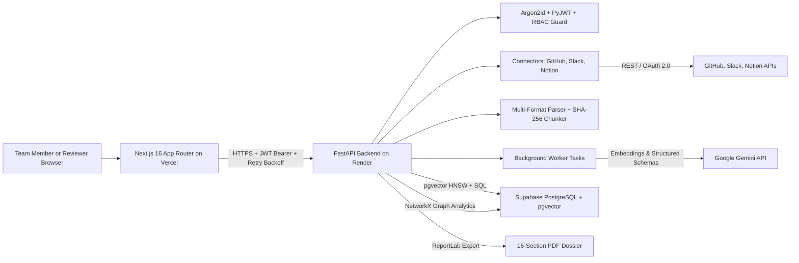
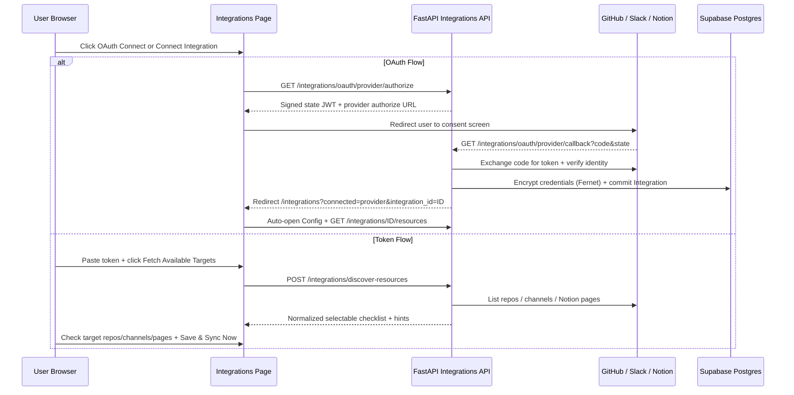

# TEAM OBSIDIAN — End-to-End System Workflow & Architecture

**Live Web App:** `https://team-obsidian.vercel.app`  
**Live Backend API:** `https://team-obsidian-api.onrender.com`  
**API Docs (Swagger):** `https://team-obsidian-api.onrender.com/docs`  
**Repository:** `https://github.com/Krishnadeepsinh/team-obsidian`

TEAM OBSIDIAN converts fragmented engineering activity across GitHub, Slack, Notion, and uploaded project documents into an evidence-verified Knowledge Graph and a structured **16-Section Handover Dossier** with cryptographic provenance (`SHA-256`) and multi-role sign-offs.

---

## 1. End-to-End Platform Architecture

---

## 2. Step-by-Step Operational Workflow

### Stage 1 — Authentication, Multi-Tenant Provisioning & RBAC
1. **Sign Up / Login (`/register`, `/login`)**:
   - Passwords are hashed using **Argon2id** (`argon2-cffi`), with transparent legacy hash upgrade upon login.
   - New user registration provisions an isolated **Organization**, personal **Workspace**, and owner **User** row inside `organizations`, `workspaces`, and `users`.
   - Every response strips secrets/hashes and issues an HS256 JWT token (`obsidian_token`) persisted in browser storage along with active project resolution (`resolveActiveProjectId`).
2. **Project & Member Access (`project_members`)**:
   - Every tenant-scoped API endpoint enforces `verify_project_access(project_id, current_user, db, require_write=..., require_admin=...)`.
   - Supported roles cover `org_admin`, `workspace_owner`, `project_owner`, `project_manager`, `tech_lead`, `developer`, `departing_employee`, `incoming_employee`, and `viewer`.
3. **Empty-Workspace Isolation**:
   - Newly registered accounts start completely clean with zero hardcoded sample data, guided through `/onboarding` -> `/projects` -> `/integrations` -> `/documents` -> `/handover`.

---

### Stage 2 — Source Integration Onboarding, Resource Picker & Deduplicated Sync
Users connect **GitHub**, **Slack**, and **Notion** on `/integrations` via either **OAuth 2.0** or **API / Personal Access / Bot Token**:

- **Target Resource Discovery**:
  - **GitHub (`GitHubConnector`)**: Lists repositories across `owner, collaborator, organization_member`, with automatic fallback to `/user/installations/{id}/repositories` for GitHub App user tokens (`ghu_...`), plus automatic `refresh_oauth_token` rotation if an expiring user token triggers `401`.
  - **Slack (`SlackConnector`)**: Lists public and private channels (`conversations.list`), highlights channels where `@Team Obsidian` is already invited, and supports single or multi-channel config targets.
  - **Notion (`NotionConnector`)**: Queries `/search` for shared pages and databases (`list_accessible_resources`) and filters targeted syncs by normalized UUID (`targets` / `database_id` / `page_id`).
- **Incremental Deduplicated Sync (`POST /api/v1/integrations/{id}/sync`)**:
  - Tracks per-target watermarks in `integ.sync_cursor`.
  - Normalizes fetched PRs, commits, issues, review threads, Slack messages/threads, and Notion blocks/database rows into `SourceRecord` rows deduplicated by `(integration_id, source_type, external_id)` and `sha256_hash`.
  - Mirrors each imported record into verifiable `Evidence` items and schedules asynchronous background AI extraction (`BackgroundTasks`) via an isolated `SessionLocal()` session so the HTTP response returns quickly without blocking or losing committed records.

---

### Stage 3 — Multi-Format Document Ingestion & Provenance (`/documents`)
1. **Upload Validation (`POST /api/v1/documents/upload`)**:
   - Rejects empty payloads, dangerous executables (`.exe`, `.sh`, `.ps1`, `.js`, etc.), legacy binary Office formats (`.doc`/`.xls` rejected with `400` guidance to save as `.docx`/`.xlsx`), and payloads > 25 MB.
2. **Format-Specific Parsing (`document_parser.py`)**:
   - **PDF**: `pymupdf` (`fitz`) page-by-page extraction; scanned image-only PDFs without embedded text return a clear `400` validation error.
   - **DOCX / XLSX**: `python-docx` paragraphs/tables and streaming `openpyxl(..., read_only=True)` worksheet rows.
   - **HTML / Markdown / CSV / JSON / YAML / SQL / XML / TXT**: Clean text normalization via BeautifulSoup / structural chunking.
3. **Database Persistence & Vector Indexing**:
   - Strips NUL (`\x00`) bytes and bounds string column lengths (`VARCHAR(N)`) safely for PostgreSQL.
   - Splits documents into structural `DocumentChunk` records, creates linked `Evidence` rows (`source_url: /documents?doc=<id>`), computes 384-dim embeddings (`gemini-embedding-001` in production; local `BAAI/bge-small-en-v1.5` fallback in dev) inside `EmbeddingRecord`, and triggers background structured knowledge extraction.

---

### Stage 4 — AI Knowledge Extraction, Graph Analytics & Global Search
1. **Structured Extraction (`knowledge_extractor.py`)**:
   - Reads unindexed project `Evidence` batches and calls Google Gemini (`google-genai` SDK with structured Pydantic `StructuredKnowledgeBundle` output and automatic tier fallback across Gemini Flash / Flash-Lite models).
   - Persists deduplicated records across `knowledge_entities`, `knowledge_relationships`, `decisions`, `task_items`, `risk_items`, `dependencies`, `responsibilities`, and `knowledge_gaps`.
2. **Knowledge Graph & Blast Radius (`/knowledge/graph`)**:
   - `NetworkX` computes centrality, downstream blast radius (`GET /api/v1/graph/blast-radius/{node_id}`), and Single Points of Failure (`spof_warnings`).
   - Interactive `@xyflow/react` canvas supports filtering by entity type, live search, node inspection, and on-demand **AI Extract Knowledge Graph**.
3. **Global Search (`Cmd+K` / `Ctrl+K`) & Unified Explorer (`/knowledge/explorer`)**:
   - Top header shortcut focuses the search input and navigates to `/knowledge/explorer?search=<query>`, syncing URL query params and live project switches (`obsidian_project_changed`) across Decisions, Tasks, Risks, Knowledge Gaps, and Entities.

---

### Stage 5 — Evidence Verification, Governance Trackers & RAG Assistant
- **Evidence Center (`/evidence`)**: Filter items by `Draft / AI Suggested`, `Supported by Evidence`, `Needs Human Verification`, `Verified by Reviewer`, `Contradicted`, `Outdated`, or `Unknown / Missing Evidence`, and submit signed `EvidenceReview` audit decisions.
- **Architectural Trackers**: Create and manage Decisions (`/decisions`), Tasks (`/tasks`, including departing-lead filters and one-click successor reassignment), Technical Risks (`/risks`), and Knowledge Gaps (`/gaps`, open/resolve toggle).
- **Evidence-Grounded AI Assistant (`/assistant`)**:
  - Embeds the user's question (`384-dim` vector), runs hybrid `pgvector` HNSW cosine similarity + normalized keyword overlap ranking over project `EmbeddingRecord`s, and passes top evidence snippets to Gemini (`AssistantSynthesisOutput`).
  - Returns clickable source citations and a multi-factor confidence breakdown, or explicitly refuses (`is_grounded: false`) when supporting project evidence does not exist.

---

### Stage 6 — 16-Section Handover Dossier Lifecycle (`/handover`)
1. **Reconstruction Wizard (`POST /api/v1/handovers/reconstruct`)**:
   - Collects departing/incoming personnel, selected integrations/categories, and custom required approvers.
   - Generates a structured 16-section transition dossier (`handovers`, `handover_sections`, `handover_claims`, `handover_approvals`) linked to supporting `Evidence` IDs and weighted confidence scores.
2. **Collaborative Review & Versioning**:
   - Reviewers edit section markdown (creating immutable snapshots in `handover_versions` viewable at `/handover/history`), post comments, and verify/reject individual claims or sections.
3. **Multi-Role Sign-Off & PDF Export (`/handover/approvals`, `/handover/{id}/pdf`)**:
   - Designated approvers record `approved` / `rejected` decisions, transition handover lifecycle status (`published`, `archived`), and export a print-ready **ReportLab PDF** dossier.

---

## 3. Application Route Map (Frontend — Next.js App Router)

| Category | Routes |
| --- | --- |
| **Public & Onboarding** | `/landing`, `/login`, `/register`, `/forgot-password`, `/onboarding` |
| **Core Workspace** | `/` (Dashboard), `/dashboard`, `/projects`, `/projects/[id]`, `/integrations`, `/documents` |
| **Intelligence & Search** | `/evidence`, `/knowledge/explorer`, `/knowledge/graph`, `/knowledge/dependencies`, `/assistant` |
| **Engineering Trackers** | `/decisions`, `/tasks`, `/risks`, `/gaps` |
| **Handover Lifecycle** | `/handover`, `/handover/approvals`, `/handover/history` |
| **Governance & Telemetry** | `/timeline`, `/activity`, `/logs`, `/team`, `/notifications`, `/profile`, `/settings` |

---

## 4. Production Deployment & Memory/Timeout Safeguards
- **Frontend (`Vercel`)**: Static + dynamic Next.js 16 build (`31/31` routes) with `NEXT_PUBLIC_API_URL` targeting Render and automatic `obsidian_project_changed` state recovery.
- **Backend (`Render`)**: `uvicorn app.main:app` with `Alembic` startup migrations (`python -m alembic upgrade head`), IPv4 Supabase Pooler PostgreSQL connection pooling, Fernet secret encryption, `384-dim` API embeddings (`gemini-embedding-001`) in production to stay well inside 512 MB RAM limits, and `BackgroundTasks` isolation for heavy LLM extraction.
- **Cold-Start Resilience**: Client `api.ts` retries transient `502`/`503`/`504` gateway wake-up responses cleanly (`2s -> 4s -> 6s` backoff).
